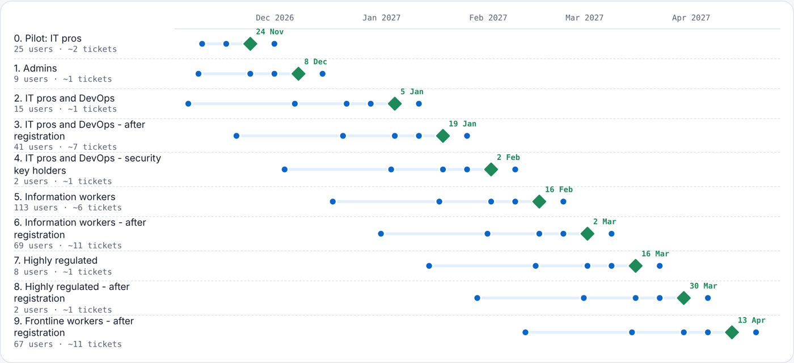

# Phishing-Resistant Cutover Planner

**Plan the move to passkeys and Token Protection before you flip the switch.** The planner reads Microsoft Entra ID's authentication-method registrations and 30 days of sign-in logs. It shows who would be locked out if you enforced phishing-resistant MFA today, and which apps, protocols and devices are in the way. Then it builds a wave-by-wave rollout plan with dates, help desk estimates, a communications calendar and report-only Conditional Access policies.

[**View the sample plan**](https://aayyagar.github.io/cutover-planner/sample-report/) · PowerShell 7 · MIT license · v1.0.0

```text
PS> .\Invoke-CutoverPlanner.ps1 -Demo

  Ready today: 168 of 420  ·  would be locked out: 252  ·  blocked by apps/devices: 69
  Token Protection ready: 187 of 413 in scope
  Plan: 10 waves from 2026-11-02 to 2027-04-13
```



---

## Why this exists

Phishing-resistant MFA (passkeys, FIDO2 security keys, Windows Hello for Business, Platform SSO, certificate-based authentication) stops the adversary-in-the-middle phishing that defeats push and SMS MFA. Token Protection binds sign-in sessions to the device, so a stolen token can't be replayed elsewhere. Both are switched on with a Conditional Access policy. The hard part is everything before that:

- **Who would be locked out?** People who haven't registered a passkey, people on old phones, and the mailbox still syncing over Exchange ActiveSync.
- **What can't support it yet?** Scripts signing in with a password (ROPC), device code flow, Linux desktops without a security key, and Outlook clients that don't use the Windows sign-in broker (WAM).
- **In what order, and how fast?** Without overwhelming the help desk, and with users told 60 days ahead.

Microsoft's [deployment guidance](https://learn.microsoft.com/en-us/entra/identity/authentication/how-to-deploy-phishing-resistant-passwordless-authentication) describes the method: personas, registration campaigns, a communications countdown, waves, and one policy per platform. Its readiness workbook needs sign-in logs exported to Azure Monitor and doesn't produce a plan. The Cutover Planner reads Microsoft Graph directly and turns the method into a schedule you can run.

## What you get

| Output | Contents |
|---|---|
| `index.html` | The plan: lock-out headline, readiness by persona, fix list, Token Protection blockers, timeline, wave cards, calendar, searchable people list |
| `cutover-plan.md` | The same plan as a document for a change board or steering group |
| `readiness.csv` | Every user: persona, status, phishing-resistant methods, single-credential flag, Token Protection status, platforms, blockers, wave |
| `waves.csv` | Wave membership, for creating each wave's security groups |
| `blockers.csv` | Blockers ranked by how many people they hold back, with the fix and example users |
| `communications.ics` | Every announcement, reminder and enforcement date, to import into Outlook or a shared project calendar |
| `policies/Wnn-*.json` | Report-only Conditional Access policies per wave: *Require authentication strength – Phishing-resistant MFA*, and *Require Token Protection* for the platforms each wave's ready users sign in from |

The policies use the [Conditional Access Policy Library](https://github.com/aayyagar/conditional-access-library) JSON format and its `{{BREAK_GLASS_GROUP_ID}}` placeholder. Test them with [Policy Replay](https://github.com/aayyagar/policy-replay) before you switch them on.

## How readiness is worked out

**Phishing-resistant MFA, per user:**

| Status | Meaning |
|---|---|
| **Ready** | Has a phishing-resistant method registered, and nothing in their recent sign-ins would stop them using it |
| **Needs registration** | No phishing-resistant method yet; goes into a wave after the registration campaign |
| **Needs a security key** | Signs in only from Linux, where Windows Hello and Platform SSO aren't available |
| **Blocked** | A hard blocker in their own traffic: a legacy protocol, ROPC or an unsupported OS. Fixed before they're scheduled |

Blockers come from each user's sign-ins:

- **Legacy clients:** Exchange ActiveSync, IMAP, POP and SMTP AUTH can't do any MFA.
- **ROPC:** password grants from scripts. Move them to workload identities.
- **OS versions** below Microsoft's minimums for phishing-resistant sign-in: Windows 10, macOS 13, iOS 17, Android 14.
- **Device code flow:** flagged to plan for, because it's phishable.
- **Single credential:** Microsoft recommends at least two per user.

**Token Protection, per user:** the planner reads the binding status Entra records on each sign-in (`tokenProtectionStatusDetails`, *bound* or *unbound* with a reason code). Codes are translated: 1002 device not registered, 1003 unsupported registration type, 1006 OS not supported, 1008 client not using WAM. Without that telemetry it infers binding from device state (registered or joined Windows, MDM-managed macOS and iOS). Only native Exchange, SharePoint and Teams clients on Windows, macOS and iOS are in scope. Android and Linux are reported as a coverage gap, because Token Protection doesn't support them.

**Personas** follow [Microsoft's persona guidance](https://learn.microsoft.com/en-us/entra/identity/authentication/how-to-plan-persona-phishing-resistant-passwordless-authentication): admins, IT pros and DevOps, information workers, highly regulated and frontline. They come from groups you pass in (`-PersonaGroups`), admin flags, or activity (Azure management, device code). Each wave card shows Microsoft's recommended method for its persona.

## How the waves are built

1. **Pilot:** up to 25 ready IT pros, about three weeks after the start date.
2. **Admins:** everyone with an admin role, including those who still need to register (issue a Temporary Access Pass or a key).
3. **Each persona in turn:** first the users who are ready, then those who register during the campaign, then security-key holders. Waves are split so expected tickets stay under `-HelpdeskTicketsPerWeek`.
4. **Enforcement** every `-WaveIntervalDays` (14 by default), always on a Tuesday. User waves start no earlier than 60 days after kick-off, so the full countdown fits.
5. **Communications** per wave: 60, 30, 14, 7 and 1 days before enforcement, then a check-in a week after. Admins and the pilot get shorter countdowns. Messages that fall on a weekend move to a working day.

External users, service accounts using user credentials and break-glass accounts are never scheduled. They're listed separately with what to do instead.

## Quick start

```powershell
git clone https://github.com/aayyagar/cutover-planner.git
cd cutover-planner
.\Invoke-CutoverPlanner.ps1 -Demo
```

The demo is a fictional Contoso tenant: 441 accounts and 89,459 sign-ins across Sales, Finance, Engineering, IT, retail stores and more.

### On your tenant

```powershell
Install-Module Microsoft.Graph.Authentication -Scope CurrentUser
Connect-MgGraph -Scopes AuditLog.Read.All, UserAuthenticationMethod.Read.All, User.Read.All, GroupMember.Read.All
.\Invoke-CutoverPlanner.ps1 `
    -PersonaGroups @{ Frontline = '<group id>'; Regulated = '<group id>'; ITPro = '<group id>' } `
    -BreakGlassUpn breakglass01@contoso.onmicrosoft.com, breakglass02@contoso.onmicrosoft.com `
    -StartDate 2026-11-02 -HelpdeskTicketsPerWeek 40
```

All calls are `GET`. The registration report and sign-in logs need Entra ID P1 or P2. Large tenants have many sign-ins, so the first run can take a while. Use `-InputPath` to re-plan from a saved snapshot.

| Parameter | Default | Purpose |
|---|---|---|
| `-Demo` | | Plan the bundled demo tenant |
| `-InputPath` | | Plan from an offline snapshot (demo format) |
| `-PersonaGroups` | | Persona → group ID (`ITPro`, `InformationWorker`, `Regulated`, `Frontline`) |
| `-BreakGlassUpn` | | Accounts never to schedule |
| `-StartDate` | next Monday | Kick-off and registration campaign |
| `-HelpdeskTicketsPerWeek` | 40 | Extra tickets the help desk can absorb |
| `-WaveIntervalDays` | 14 | Days between enforcement dates |
| `-PilotSize` | 25 | Maximum pilot users |
| `-Days` | 30 | Days of sign-ins to read |
| `-OutputPath` | `.\CutoverPlan_<timestamp>` | Plan folder |

## Good to know

- **It's a plan, not an enforcement tool.** Nothing is registered, changed or sent. Re-run it at the readiness checkpoint it schedules four weeks in, and before each wave.
- **Ticket estimates** assume 5% of ready users, 15% of users who must register and 10% of key holders raise a ticket. Adjust the waves if your help desk sees different rates.
- **Token Protection policies** use the Graph beta `secureSignInSession` session control and target a separate group of fully bound users per wave.
- **Shared devices** and kiosks can't be detected from sign-in logs. Put frontline workers in a persona group so they get the FIDO2-on-behalf-of guidance.

## Project layout

```text
Invoke-CutoverPlanner.ps1   the planner (single file, dot-sourceable)
report/template.html        plan template
demo/sample-tenant.json     fictional Contoso tenant
tools/make-demo.py          regenerates the demo
tests/                      Pester 5 tests
sample-report/              the published sample plan
```

Run the tests with `Invoke-Pester ./tests`.

## References

- Microsoft Learn: [Deploy phishing-resistant passwordless authentication](https://learn.microsoft.com/en-us/entra/identity/authentication/how-to-deploy-phishing-resistant-passwordless-authentication)
- Microsoft Learn: [Plan a phishing-resistant passwordless deployment by persona](https://learn.microsoft.com/en-us/entra/identity/authentication/how-to-plan-persona-phishing-resistant-passwordless-authentication)
- Microsoft Learn: [Token Protection in Conditional Access](https://learn.microsoft.com/en-us/entra/identity/conditional-access/concept-token-protection)
- Microsoft Learn: [Token Protection deployment guide for Windows](https://learn.microsoft.com/en-us/entra/identity/conditional-access/deployment-guide-token-protection-windows)
- Microsoft Graph: [userRegistrationDetails](https://learn.microsoft.com/en-us/graph/api/resources/userregistrationdetails)

## License

MIT © 2026 Akhilesh Ayyagari
